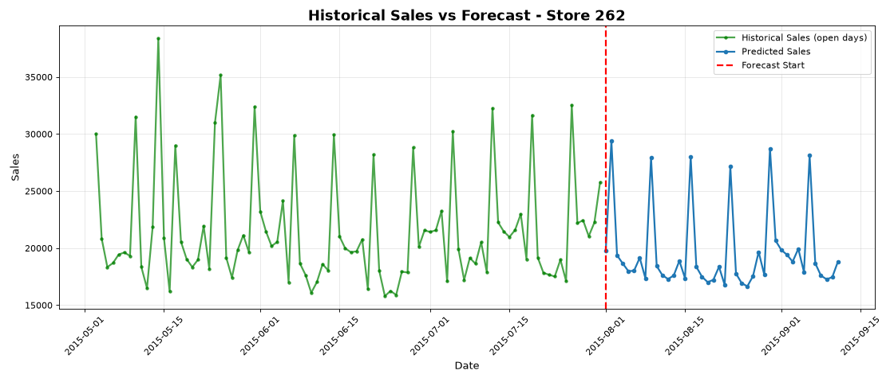

# 🛒 Rossmann Store Sales Forecasting

> Daily sales forecasting for the 1,115 stores in the Kaggle Rossmann Store Sales data: a LightGBM model validated on a 46-day chronological holdout, plus a Streamlit dashboard.

[](https://www.python.org/)
[](https://lightgbm.readthedocs.io/)
[](https://streamlit.io/)
[](LICENSE)



*Dashboard chart: store 262, 42 days from 2015-08-01, 6-week-horizon model, no promotion.*

---

## 🎯 Overview

- **Data**: 1,017,209 store-day records (2013-01-01 to 2015-07-31) from [Kaggle](https://www.kaggle.com/c/rossmann-store-sales).
- **Model**: LightGBM on 34 engineered features (calendar, promo, competition, store averages, lag/rolling sales history).
- **Validation**: 46-day chronological holdout, never used for fitting or early stopping. **13.9% RMSPE** when forecasting the whole 6 weeks at once, **12.7%** one day ahead, against **29.0%** for a seasonal-naive baseline.
- **Dashboard**: Streamlit app that forecasts one store 7 to 90 days ahead, with a promotion toggle and CSV export.

No business impact (savings, stockouts, planning time) has been measured; the model has not been used in production.

---

## 📊 Model Performance

### Setup

- **Data**: Kaggle `train.csv`, open days with Sales > 0 (the Kaggle metric ignores zero-sales days).
- **Validation (holdout)**: 2015-06-16 to 2015-07-31, 44,738 store-days, all 1,115 stores.
- **Early stopping**: 2015-05-05 to 2015-06-15 (37,470 rows). **Fit**: 2013-01-31 to 2015-05-04 (728,680 rows).
- Full numbers: [`results/metrics.json`](results/metrics.json). Reproduce with `python -m src.evaluate`.

### Validation Results

| Model | RMSPE | RMSE | MAE |
|-------|-------|------|-----|
| Seasonal naive: same weekday, last training week (6-week horizon) | 29.0% | 2,111 | 1,481 |
| Seasonal naive: actual sales 7 days earlier (1-day-ahead) | 39.7% | 2,763 | 2,160 |
| **LightGBM, 6-week horizon** (31 features, no sales history; used by the dashboard) | **13.9%** | **939** | **649** |
| **LightGBM, 1-day-ahead** (49 features) | **12.7%** | **845** | **594** |

RMSE and MAE are in the dataset's daily sales units. Everything runs on a laptop CPU (no GPU): training took 113 s for the 1-day-ahead model (560 boosting rounds) and 87 s for the 6-week model (826 rounds); the whole run, including preprocessing and feature engineering, takes about 3–7 minutes depending on machine load.

**Which number to quote.** The 1-day-ahead model's lag, rolling and EWM features use the actual sales of the preceding days, so it assumes yesterday's sales are known when forecasting today. Forecasting weeks ahead (the Kaggle task, and the dashboard) needs the 6-week-horizon model, which drops every sales-history feature (the shortest lag, 30 open days, is shorter than the 46-day holdout). 13.9% is the fair number for that use.

### Feature Importance (Top 10, 1-day-ahead model, share of total gain)

1. `Sales_EWM_7` (33.9%)
2. `Sales_RollingMean_14` (17.3%)
3. `Promo` (12.7%)
4. `DayOfWeek` (6.6%)
5. `Store_AvgSales` (5.5%)
6. `Sales_EWM_14` (4.6%)
7. `Store` (4.1%)
8. `Sales_EWM_30` (2.1%)
9. `Day` (2.0%)
10. `DayOfYear` (1.9%)

For the 6-week-horizon model the top features are `Store_AvgSales` (43.6%), `Store` (19.9%) and `Promo` (15.1%).

---

## ⚡ Pipeline

### Data processing (`src/data/data_preprocessing.py`)

- Merges `train.csv` (1,017,209 rows) with `store.csv` (1,115 stores).
- Fills the 2,343 missing values in `store.csv` (no competitor: distance 100,000 m and year 1900; not in Promo2: zeros and `None`).
- Removes 172,817 closed-day rows and 54 open days with zero sales, leaving 844,338 rows.

### Feature engineering (`src/features/feature_engineering.py`)

34 new features, 52 columns in total; the model uses 49 of them (all except `Sales`, `Date`, `Customers`).

- **Calendar**: Year, Month, Day, WeekOfYear, Quarter, DayOfMonth, DayOfYear, IsWeekend, IsMonthStart, IsMonthEnd
- **Promo / competition**: Promo2Active, CompDistanceTransformed, CompetitionOpenMonths, HasCompetition
- **Store averages**: mean and standard deviation of sales per store, from training dates only (before 2015-06-16)
- **Sales history**: lags (7, 14, 30), rolling mean/std/min/max (7, 14, 30) and EWMs (7, 14, 30), all over previous days only. Lags and windows count open days, not calendar days.

The first 30 open days of each store have no 30-day lag and are dropped (33,450 rows), leaving 810,888 rows in `data/processed/train_features.csv`.

---

## 🚀 Quickstart

Tested on Windows 11 with Python 3.12, CPU only.

### 1. Clone and install

```bash
git clone https://github.com/SuppaTessta/Retail-Demand-Forecasting.git
cd Retail-Demand-Forecasting
python -m venv .venv
```

Activate the environment, then install:

```bash
# Windows (PowerShell): .\.venv\Scripts\Activate.ps1
# macOS/Linux:          source .venv/bin/activate
pip install -r requirements.txt
```

### 2. Download the data

1. Sign in to [Kaggle](https://www.kaggle.com/) and accept the competition rules at <https://www.kaggle.com/competitions/rossmann-store-sales/rules> (the join/accept button on that page). Without this the download fails with `403 Forbidden`.
2. Create an API token (Kaggle → Settings → API → Create New Token) and set it up as described in the [Kaggle CLI authentication docs](https://github.com/Kaggle/kaggle-cli/blob/main/docs/README.md#authentication), for example by saving the token in `~/.kaggle/access_token` or a legacy `kaggle.json` in `~/.kaggle/`.
3. Download and extract into `data/raw/`:

```bash
kaggle competitions download -c rossmann-store-sales -p data/raw
python -c "import zipfile; zipfile.ZipFile('data/raw/rossmann-store-sales.zip').extractall('data/raw')"
```

### 3. Train and validate

```bash
python -m src.evaluate
```

This preprocesses the data, builds the features, trains both LightGBM variants and the baselines (3–7 minutes on a laptop CPU), and writes `results/metrics.json`, `data/processed/train_features.csv`, `models/lightgbm_horizon_model.pkl` and `models/lightgbm_best_model.pkl`. `notebooks/05_complete_modeling.ipynb` runs the same script and adds charts.

### 4. Launch the dashboard

```bash
streamlit run app/app.py
```

Opens at `http://localhost:8501`. Choose a store, a start date (from 2015-08-01) and 7 to 90 days, optionally turn on the promotion, then click **Generate Forecast**. The forecast table can be downloaded as CSV.

**How the dashboard forecasts.** It uses the 6-week-horizon model, so every input is known in advance. It assumes the store is open Monday to Saturday with no state or school holiday; Sundays are 0 for the 1,082 stores that never opened on a Sunday in 2013–2015. The promotion toggle applies Monday to Friday only, as in the data. The shaded ±10% band is illustrative, not a confidence interval. The model was trained on data up to 2015-05-04 and validated only up to 46 days ahead; longer horizons are not validated.

---

## 📓 Notebooks

| Notebook | What it does | Needs | Outputs saved |
|----------|--------------|-------|---------------|
| `01_data_exploration.ipynb` | Exploratory analysis of the raw data | `data/raw/` | yes |
| `02_preprocessing_summary.ipynb` | Summary of the preprocessed data | `python src/data/data_preprocessing.py` | yes |
| `03_feature_analysis.ipynb` | Correlation of features with sales (exploratory) | `python -m src.evaluate` | no, unexecuted (loading the 320 MB feature file took over 2 minutes) |
| `04_modeling.ipynb` | Chronological train/validation split check only | `python -m src.evaluate` | yes |
| `05_complete_modeling.ipynb` | Full validation run with charts (calls `src/evaluate.py`) | `data/raw/` | yes, from a run before the horizon model was saved; metrics match `results/metrics.json` |

---

## 📁 Project Structure

```text
Retail-Demand-Forecasting/
├─ app/
│  ├─ app.py                      # Streamlit dashboard
│  └─ pages/1_📚_About.py
├─ data/                          # not in Git
│  ├─ raw/                        # Kaggle files: train.csv, test.csv, store.csv, sample_submission.csv
│  └─ processed/                  # train_features.csv (written by src.evaluate)
├─ models/                        # trained models (not in Git)
├─ notebooks/                     # 01-05, see above
├─ outputs/figures/               # dashboard_preview.png (README chart)
├─ results/metrics.json           # validation results
├─ src/
│  ├─ evaluate.py                 # leak-free validation run (python -m src.evaluate)
│  ├─ data/                       # data_preprocessing.py, verify_preprocessing.py
│  ├─ features/                   # feature_engineering.py, verify_features.py
│  ├─ models/                     # ml_models.py (LightGBM), baseline_models.py, statistical_models.py
│  └─ evaluation/metrics.py       # RMSPE, RMSE, MAE, MAPE
├─ check_data.py                  # checks the raw Kaggle files load
├─ test_install.py                # checks the dependencies import
└─ requirements.txt
```

`python src/data/data_preprocessing.py` and `python src/features/feature_engineering.py` can also be run on their own (they write `train_preprocessed.csv`, `test_preprocessed.csv`, `train_features.csv` and `test_features.csv` to `data/processed/`), but `python -m src.evaluate` does not need them.

---

## ⚠️ Known Limitations

- The dashboard ignores state and school holidays, and does not refit the model on data after 2015-05-04.
- No prediction intervals; the ±10% band is illustrative.

---

## 🛠️ Technologies

Tested with Python 3.12.10, pandas 2.3, NumPy 2.5, LightGBM 4.7, scikit-learn 1.9, Matplotlib 3.11, seaborn 0.13 and Streamlit 1.67 (minimum versions in `requirements.txt`).

---

## 🔮 Future Improvements

- Use the Kaggle `test.csv` calendar (open days, promos, holidays) for dashboard forecasts in that period
- Add prediction intervals (for example quantile LightGBM)
- Add external data (weather, regional holidays)
- Refit on the full history for deployment
- Docker image and CI

---

## 📄 License

This project is licensed under the **MIT License**; see [LICENSE](LICENSE).

**Dataset License**: Kaggle competition data used under Kaggle's competition rules; it is not redistributed in this repository.

---

## 🙏 Acknowledgments

- **Kaggle** for hosting the Rossmann Store Sales competition
- **Rossmann** for providing the dataset
- **LightGBM** developers for the excellent library
- **Streamlit** team for the web framework
- www.perplexity.ai and github_copilot for helping me along the way

---

## 📚 References

1. [Kaggle Competition](https://www.kaggle.com/c/rossmann-store-sales)
2. [LightGBM Documentation](https://lightgbm.readthedocs.io/)
3. [Forecasting: Principles and Practice](https://otexts.com/fpp3/)
4. [Streamlit Documentation](https://docs.streamlit.io/)
